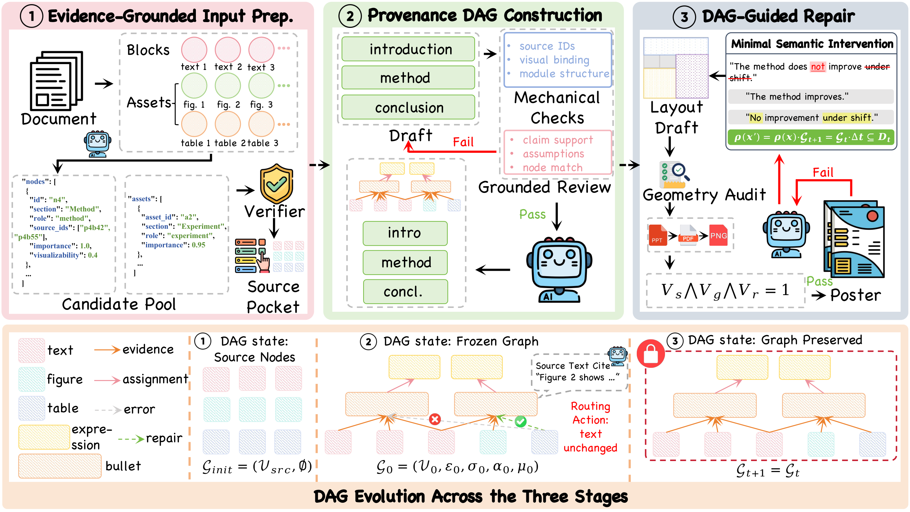
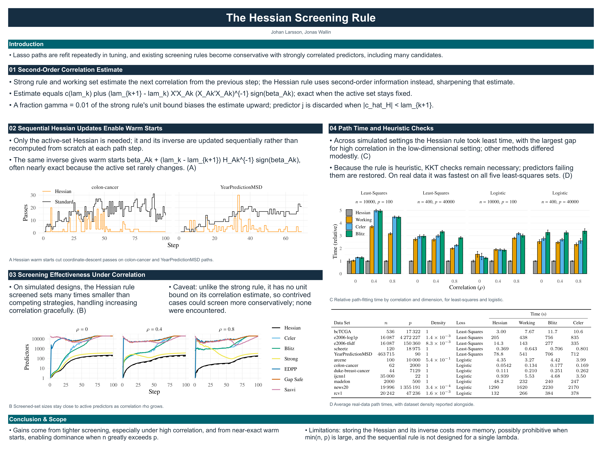
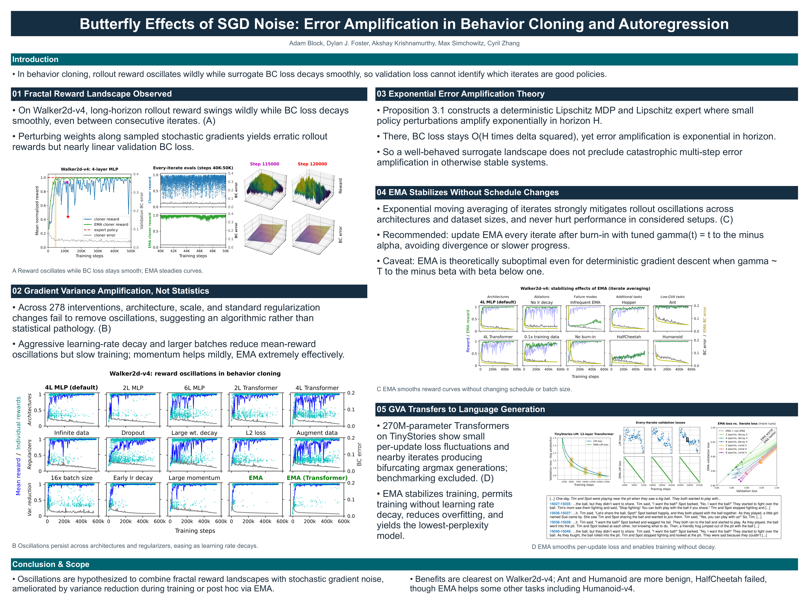
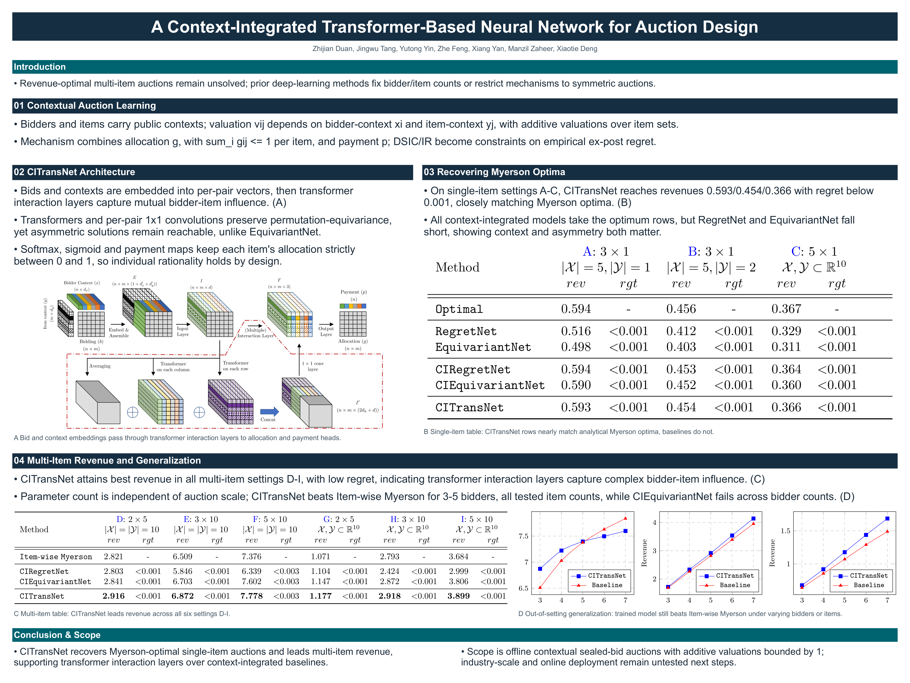
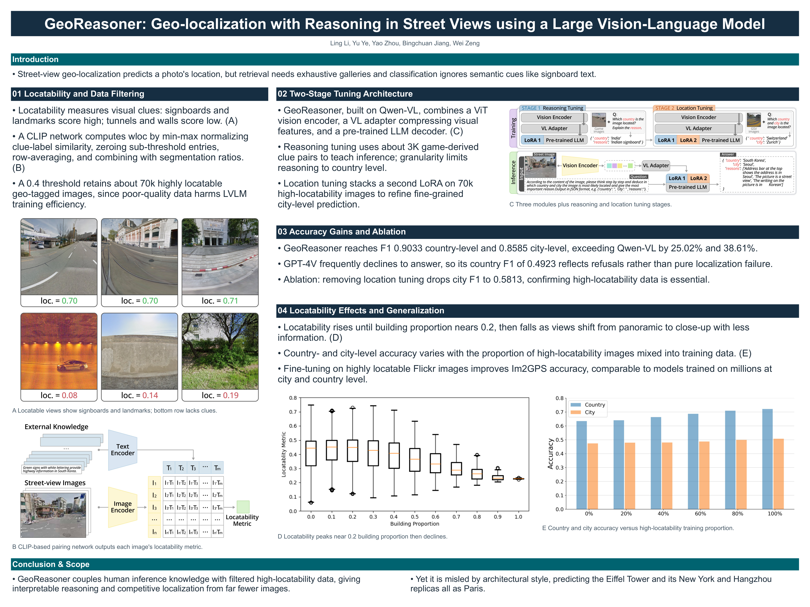
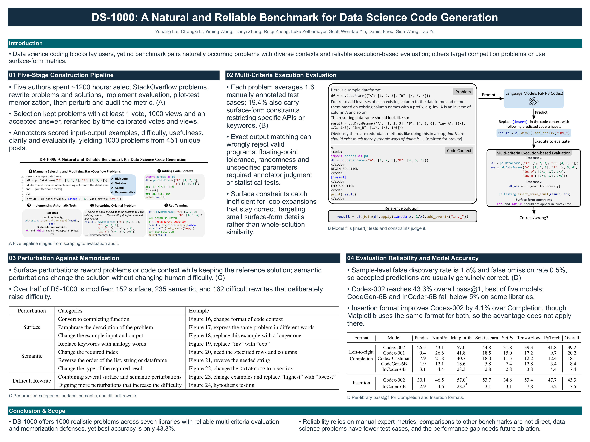
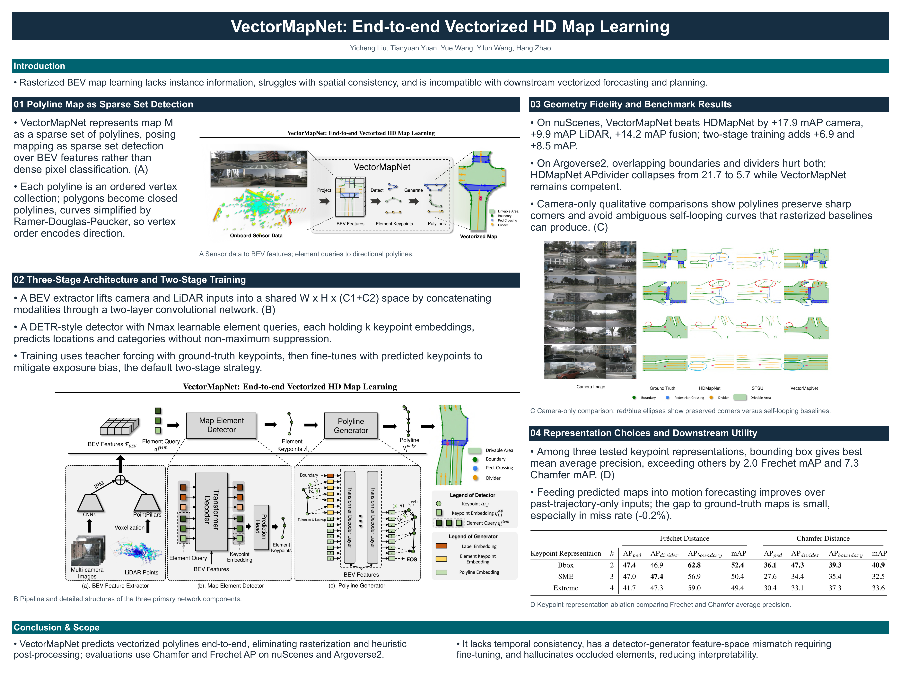

<div align="center">

# 🧩 DAGent

### Provenance-Grounded Component Compilation for Scientific Poster Generation

*From research papers to scientific posters.*

<p>
  <a href="#environment"></a>
  <a href="#generation"></a>
  <a href="#evaluation"></a>
</p>

[🖼️ Gallery](#gallery) · [⚙️ Environment](#environment) · [🚀 Generation](#generation) · [📊 Evaluation](#evaluation)

</div>

## 🧭 Method Overview

DAGent formulates scientific poster generation as **component-based compilation over a shared provenance DAG**. (1) In Evidence-Grounded Input Preparation, an Evidence Agent validates sparse pointers to assemble compact evidence packages. (2) In Provenance DAG Construction, a Writing Agent generates poster expressions and links them to source evidence, visual assets, and layout modules. (3) In DAG-Guided Repair, the Repair Agent uses these links to correct targeted visual binding errors and locally compress overflowing text while preserving critical semantic markers, with geometric and glyph-level checks guiding further repair.

<p align="center">
  <a href="fig/pipeline.pdf">
    
  </a>
</p>

<p align="center">
  <em>Evidence preparation → provenance DAG construction → grounded repair and compilation.</em><br />
</p>

<a id="gallery"></a>

## 🖼️ Poster Gallery

Examples generated by DAGent. Click any preview to view the full-resolution poster.

<table>
  <tr>
    <td align="center" width="33%">
      <a href="fig/1poster.png"></a><br />
      <sub><b>1. The Hessian Screening Rule</b></sub>
    </td>
    <td align="center" width="33%">
      <a href="fig/2poster.png"></a><br />
      <sub><b>2. Butterfly Effects of SGD Noise: Error Amplification in Behavior Cloning and Autoregression</b></sub>
    </td>
    <td align="center" width="33%">
      <a href="fig/3poster.png"></a><br />
      <sub><b>3. A Context-Integrated Transformer-Based Neural Network for Auction Design</b></sub>
    </td>
  </tr>
  <tr>
    <td align="center" width="33%">
      <a href="fig/4poster.png"></a><br />
      <sub><b>4. GeoReasoner: Geo-localization with Reasoning in Street Views using a Large Vision-Language Model</b></sub>
    </td>
    <td align="center" width="33%">
      <a href="fig/5poster.png"></a><br />
      <sub><b>5. DS-1000: A Natural and Reliable Benchmark for Data Science Code Generation</b></sub>
    </td>
    <td align="center" width="33%">
      <a href="fig/6poster.png"></a><br />
      <sub><b>6. VectorMapNet: End-to-end Vectorized HD Map Learning</b></sub>
    </td>
  </tr>
</table>

<a id="environment"></a>

## ⚙️ 1. Environment

Run the following from the repository root:

```bash
conda create -n dagent python=3.10 pip -y
conda activate dagent
python -m pip install -r requirements.txt
cp .env.example .env
```

**Model configuration.** Set `DEEPSEEK_API_KEY` and `DEEPSEEK_BASE_URL` in `.env`. Generation and evaluation share [`configs/dagent.json`](configs/dagent.json), whose default model alias is `deepseek-flash`. Use the model identifier and endpoint from your experiment.

**Benchmark data.** Download the [Paper2Poster benchmark](https://huggingface.co/datasets/Paper2Poster/Paper2Poster). Place source PDFs in `benchmark/papers/` and the corresponding PaperQuiz annotations in `benchmark/qa/`:

```text
benchmark/
├── papers/
│   └── paper_001.pdf
└── qa/
    └── paper_001.json
```

<a id="generation"></a>

## 🚀 2. Poster Generation

```bash
python run.py --run-dir outputs/dagent --generate
```

The command reads `benchmark/papers/`, prepares the run, and generates a poster for each paper. Outputs are saved under `outputs/dagent/generation/<paper_id>/`:

| File | Purpose |
| :--- | :--- |
| `poster.pptx` | Editable text and image elements in PowerPoint. |
| `poster.pdf` | Document for printing and sharing. |
| `poster.png` | Poster preview and evaluation input. |

Questions and answer keys are used only for evaluation.

<a id="evaluation"></a>

## 📊 3. Evaluation

Run the two evaluation protocols independently on the same generated posters:

| Protocol | Measures | Reports |
| :--- | :--- | :--- |
| 🧠 **PaperQuiz** | How accurately paper content can be recovered from the poster. | Verbatim, Interpretive, and their mean; raw and density-adjusted scores. |
| ⚖️ **LLM-as-Judge** | Visual presentation and information quality. | Six aspect ratings and three averages. |


### 🧠 PaperQuiz

```bash
python -m evaluation.run --run-dir outputs/dagent \
  --manifest evaluation/manifest.json --metrics qa --allow-paid-evaluation
```

### ⚖️ LLM-as-Judge

```bash
python -m evaluation.run --run-dir outputs/dagent \
  --manifest evaluation/manifest.json --metrics judge --allow-paid-evaluation
```

| Score | Definition |
| :--- | :--- |
| **Six aspects** | Element, Layout, Engagement, Clarity, Content, and Logical Flow, each rated **1–5**. |
| **Aesthetic** | Mean of available Element, Layout, and Engagement ratings. |
| **Information** | Mean of available Clarity, Content, and Logical Flow ratings. |
| **Overall Judge** | Mean of available ratings across all six aspects. |

### 📁 Evaluation Results

Both protocols save their results independently under `outputs/dagent/`:

| Protocol | Aggregate scores | Per-poster records |
| :--- | :--- | :--- |
| PaperQuiz | `paperquiz_summary.json` | `paperquiz_results.json` |
| LLM-as-Judge | `llm_as_judge_summary.json` | `llm_as_judge_results.json` |


## 🙏 Acknowledgements

We thank [PosterForest (ACL 2026)](https://github.com/kaist-cvml/poster-forest) and [Paper2Poster (NeurIPS 2025 D&B)](https://github.com/Paper2Poster/Paper2Poster) for their open-source codebases.
